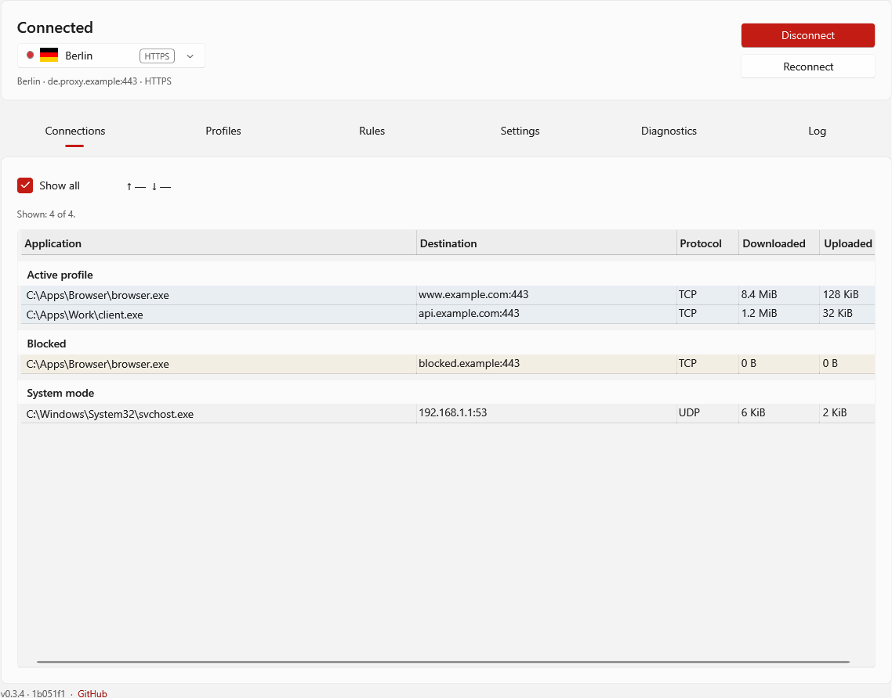
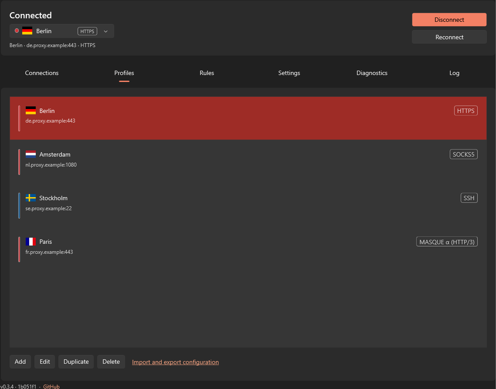

# MegaProxy for Windows

  

MegaProxy is an open-source Windows client for HTTPS, SOCKS5, SSH and experimental
MASQUE (HTTP/3) proxies, including **HTTPS and SSH Jump** connections.
Route all applications or selected traffic through servers you control or trust.
**Servers and credentials are not included.**

## Installation

Windows 10/11 x64 and an administrator account are required.

[Latest release and changelog](https://github.com/andre487/WindowsMegaProxy/releases/latest) ·
[Installation guide](docs/en/installation.md) · [Установка на русском](docs/ru/installation.md)

The installer includes both proxy cores, downloads an app-local .NET runtime when needed, and prepares Windows OpenSSH Client
if missing. Choose a personal or system-wide installation and a startup mode.
The application is signed with a self-signed certificate; Windows may show an
unrecognized-publisher warning. [Signatures and antivirus notes](docs/ANTIVIRUS.md).

1. Install MegaProxy, then add or import a proxy profile.
2. Choose the default route and add application or destination rules.
3. Select a profile and connect.
4. Open **Diagnostics** to check the connection and run a speed test.

For updates, use **Settings → Application updates** or install the latest Setup
over the existing installation, keeping its scope. Profiles and settings are preserved.
The download link always points to the latest release's installer.

Server setup: [MegaProxyServer](https://github.com/andre487/MegaProxyServer).
Other clients: [Android](https://github.com/andre487/AndroidMegaProxy) ·
[Browser](https://github.com/andre487/BrowserMegaProxy).

## Features

- HTTPS CONNECT over HTTP/1.1, optional HTTP/2 and experimental HTTP/3; HTTPS and SSH Jump.
- SOCKS5 TCP/UDP, SSH password/private-key authentication and experimental MASQUE.
- Rules for EXE files, recursive folders, domains, IP/subnet destinations and Podkop lists.
- Multiple profiles with country flags, import/export, configuration subscriptions and failover.
- IPv4/IPv6, per-profile DNS-over-HTTPS and TCP/UDP DNS; separate bootstrap DNS settings.
- Connection tables, traffic rates, connection/speed diagnostics and exit-IP reputation.
- Manual launch, sign-in startup or a Windows service; system tray and application updates.
- English/Russian, light/dark/system themes, display scaling and local rotating logs.

[Profiles and routing](docs/en/profiles-and-routing.md) · [Updates](docs/en/updates.md) ·
[English documentation](docs/en/index.md) / [Документация на русском](docs/ru/index.md)

[Troubleshooting](docs/en/troubleshooting.md) · [Решение проблем](docs/ru/troubleshooting.md)

## Screenshots

| Connections | Profiles |
| --- | --- |
|  |  |

[All sections in light and dark themes](docs/screenshots/README.md).
Screenshots use synthetic profiles and may differ from the current release.

## Privacy and security

Proxy operators can see destinations and unencrypted traffic. SOCKS5 does not encrypt
the proxy connection or its credentials. HTTPS/MASQUE verify server certificates by
default. **SSH and SSH Jump currently accept any server host key**; imported host-key
pins are preserved for compatibility but are not enforced.

Stored credentials are protected with Windows DPAPI. Logs stay local unless exported.
Diagnostics, subscriptions, DNS and enabled update checks contact their respective
services. [Privacy policy](PRIVACY.md) · [Antivirus and signing](docs/ANTIVIRUS.md).

## Development

Develop with VS Code, cmd scripts and uv; Visual Studio is not required.
[Build, DEV isolation and tests](docs/development.md) · [Installer and release automation](installer/README.md).

## License

The repository defaults to [MIT](LICENSE). The application, service and network
components are **GPL-3.0-or-later**; our installer code is MIT. Third-party components
and artwork retain their own licenses. See [license scopes and notices](LICENSING.md).
