# Application screenshots

The English interface in light and dark themes. All profiles, paths, connections,
diagnostic results and log entries are synthetic examples. No personal configuration
is loaded, and no proxy connection or network test is performed.

| Section | Light | Dark |
| --- | --- | --- |
| Connections | [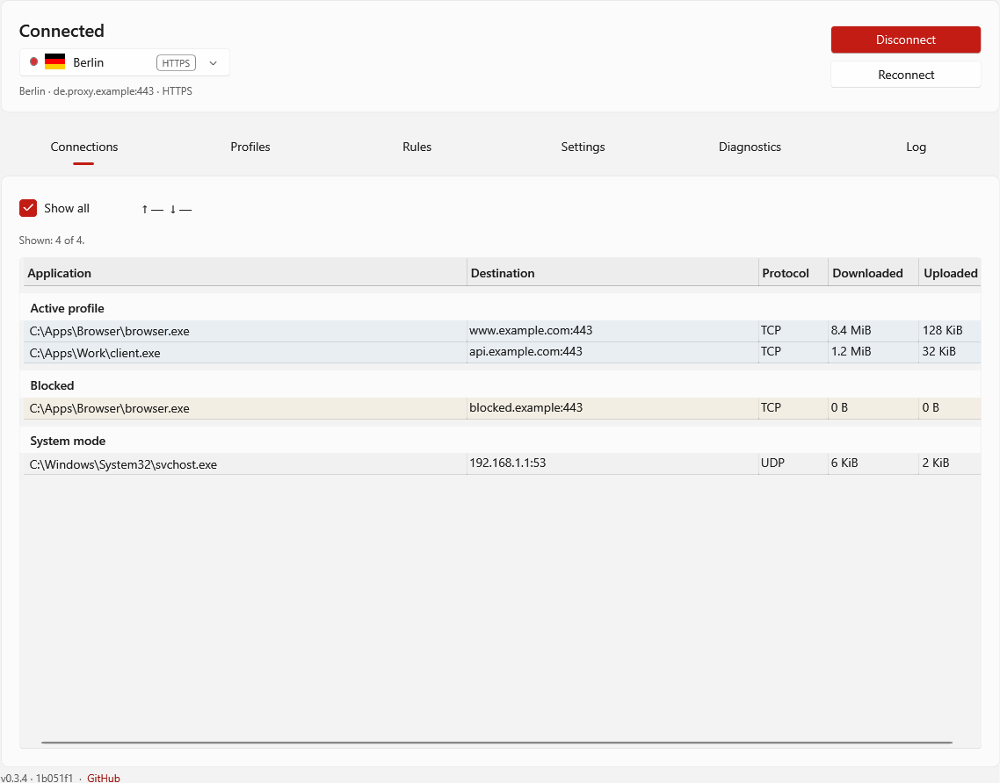](connections-light.png) | [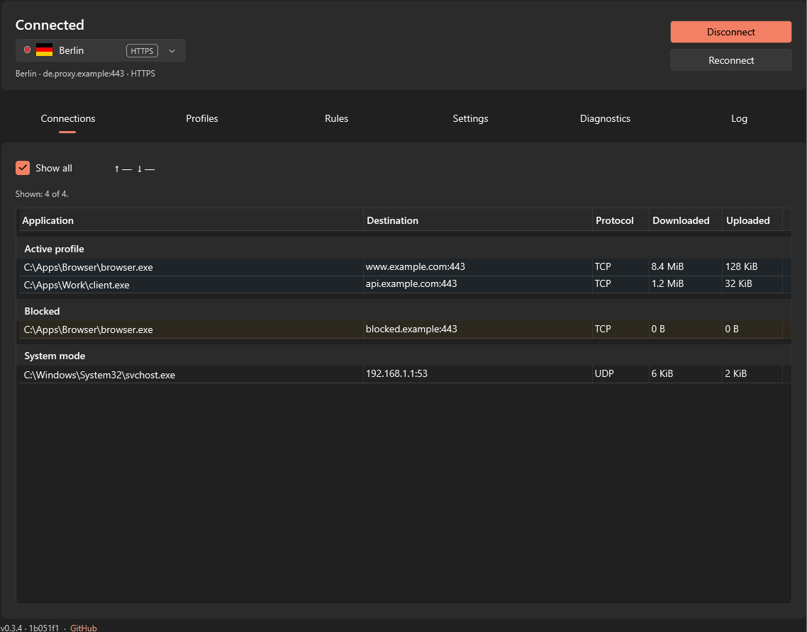](connections-dark.png) |
| Profiles | [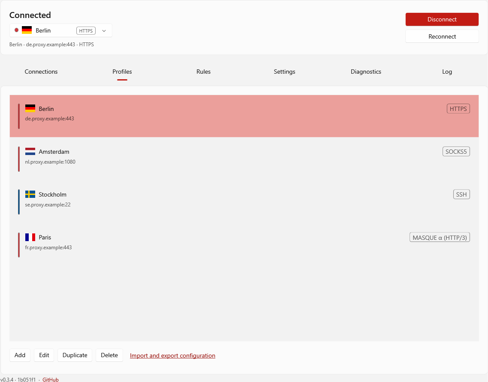](profiles-light.png) | [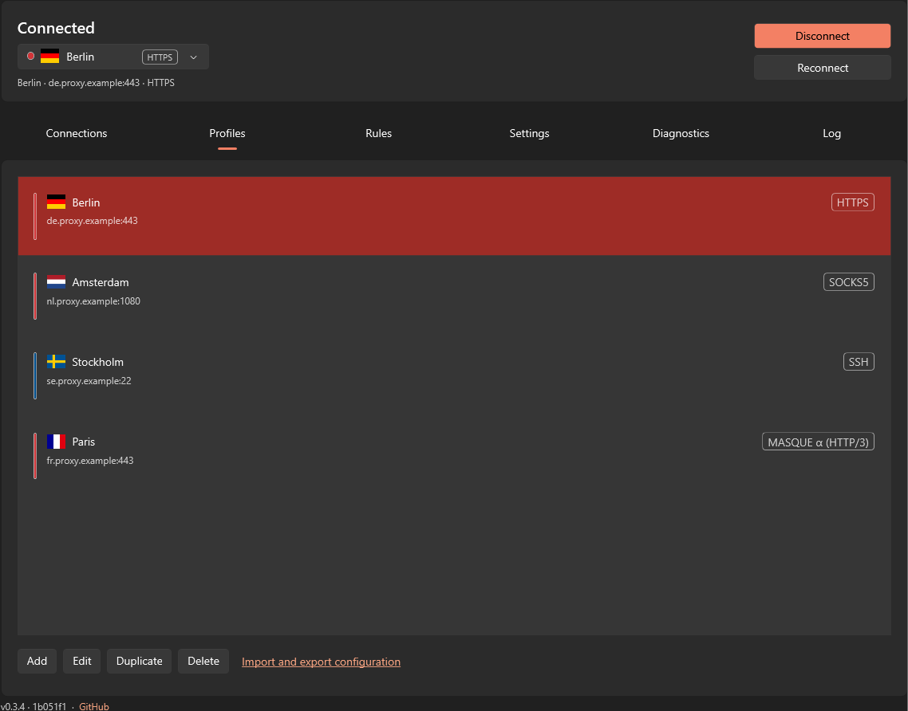](profiles-dark.png) |
| Rules | [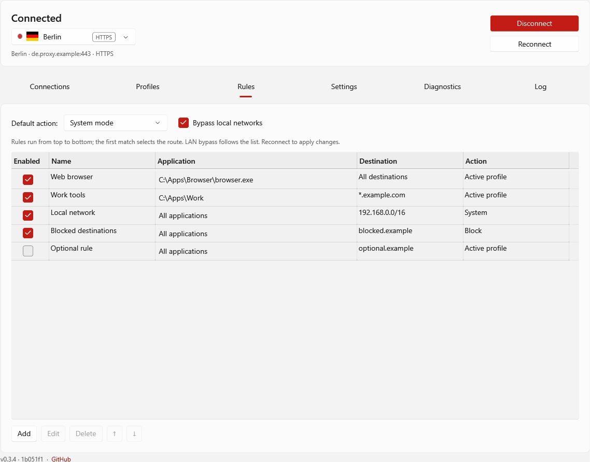](rules-light.png) | [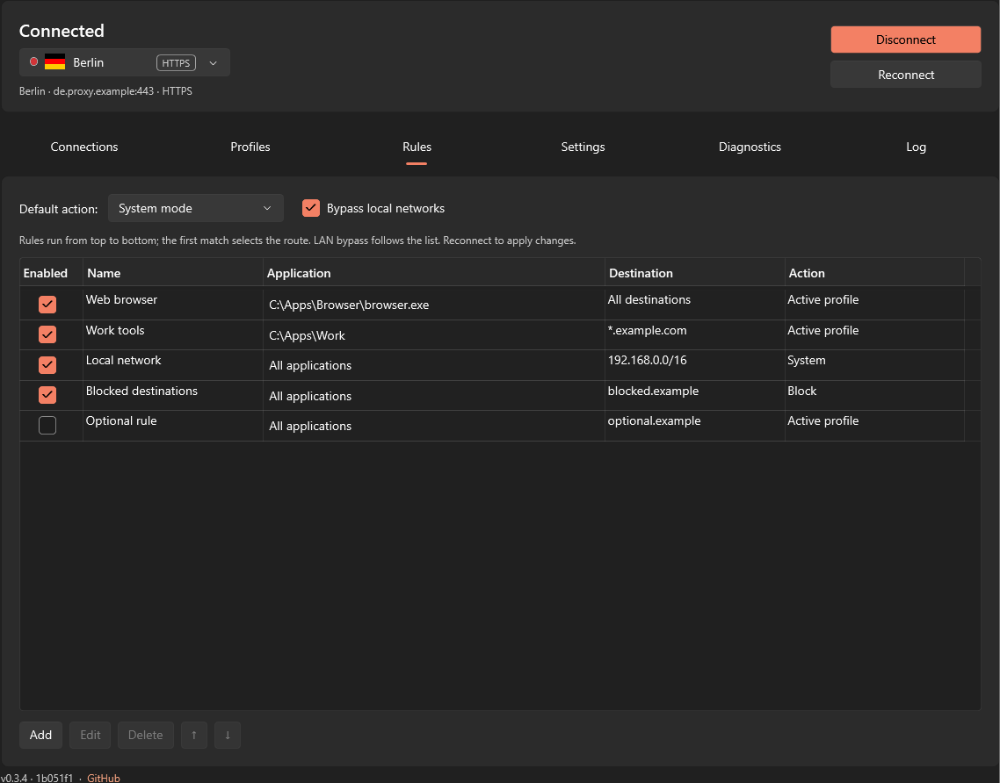](rules-dark.png) |
| Settings | [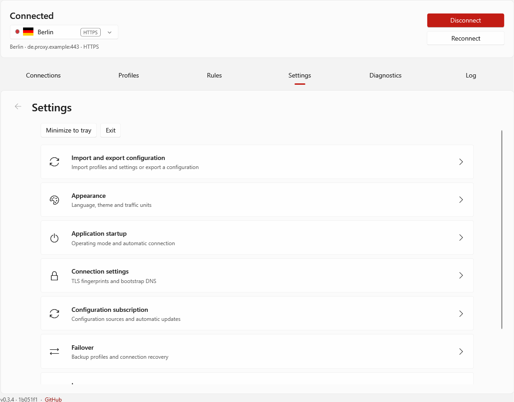](settings-light.png) | [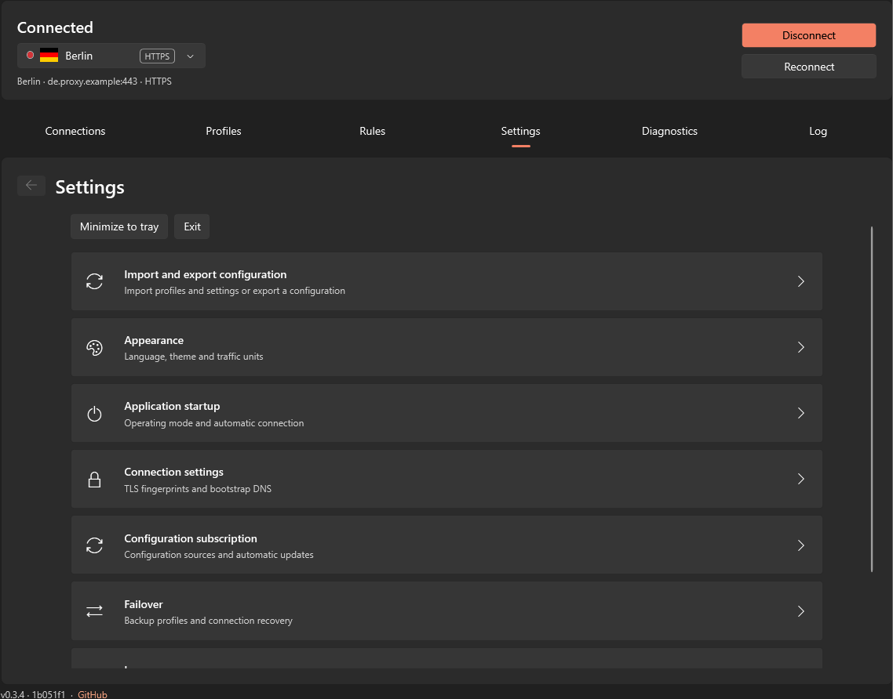](settings-dark.png) |
| Diagnostics | [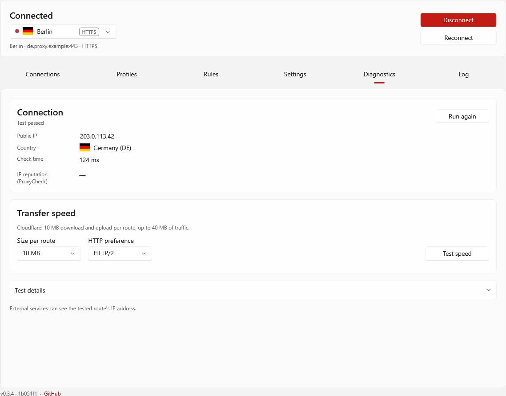](diagnostics-light.png) | [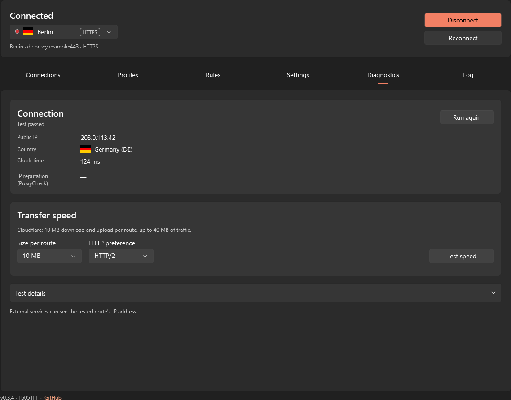](diagnostics-dark.png) |
| Log | [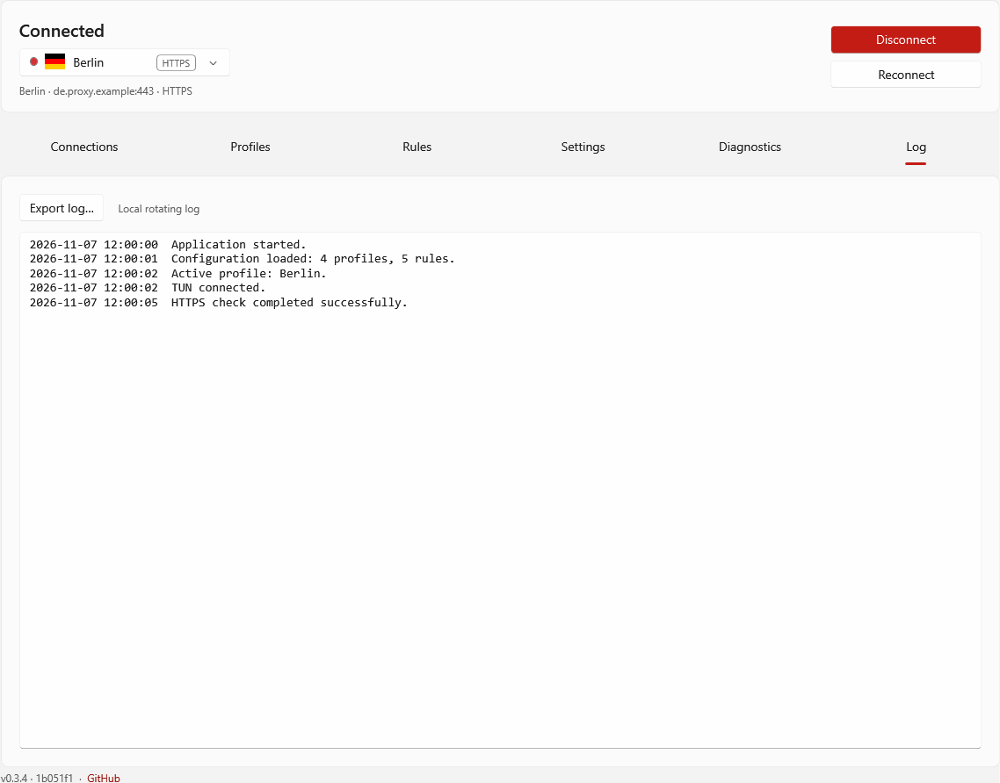](log-light.png) | [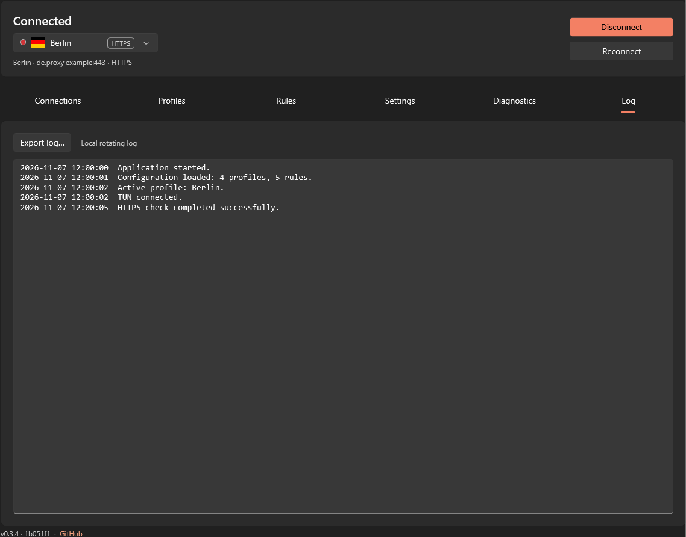](log-dark.png) |

To regenerate on Windows with the .NET SDK, from the repository root:

```cmd
scripts\dotnet.cmd run --project tests\WindowsMegaProxy.UiChecks -c Release -- --documentation-screenshots
```

Use a production build (without `MegaProxyDev=true`). The screenshot fixture uses
an in-memory configuration and a fake engine, with startup loading and timers
disabled. Its temporary logs go into `artifacts/documentation-screenshots`.
